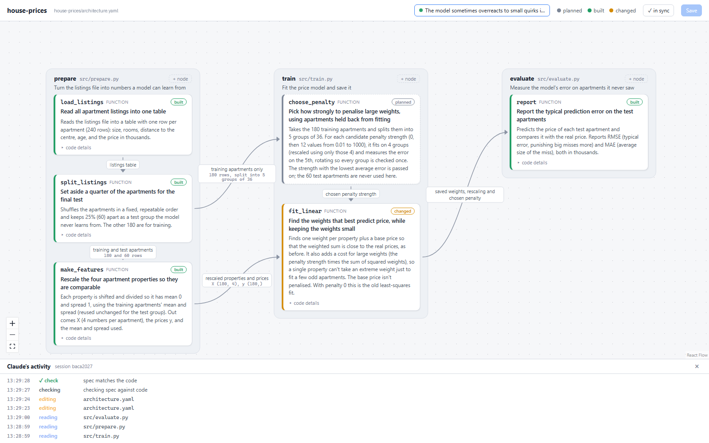

# archspec

**Understand what Claude builds in your Python/ML projects**, without reading all the code.

A Claude Code plugin for people who know the math but don't want to trace code. It adds:

- **A live, editable diagram** of your project's functions and how data flows between
  them, written in plain language. Claude plans new work into the diagram first, and you
  review and edit it before any code is written. While Claude works, the cards it is
  reading or editing light up.
- **An output style, "Explain as you go"**: a short plan with the real decisions before a
  task, and a recap after it (what changed, how data flows now, what was tested and what
  wasn't, what to watch out for).
- **`/archspec:walkthrough`**: after a change, a short document built around one worked
  example with real numbers from your code, ending with questions to check your
  understanding.

The approach is based on research showing that understanding AI-written code comes from
actively questioning it, not from reading more output
([Anthropic, 2026](https://www.anthropic.com/research/AI-assistance-coding-skills)).



## Install

In Claude Code:

```
/plugin marketplace add <your-github-name>/archspec
/plugin install archspec@archspec
```

The tool needs Python 3.10+ and one library: `python -m pip install ruamel.yaml`.

## Use it in a project

1. **Set up once:** run `/archspec:setup` in the project, then `/output-style` and pick
   **archspec:Explain as you go**.
2. **Ask** for a feature in your own words. Claude replies with a plan and adds the planned
   steps to the diagram. It doesn't write code yet.
3. **Review** with `/archspec:view`. Planned steps have a dashed outline; edit any card or
   arrow in the browser if you want something different.
4. **Approve** ("go ahead"). Claude builds it, checks the diagram against the code, and
   ends with a recap.
5. **Understand** with `/archspec:walkthrough` when the change matters.

Skip steps for small changes: a typo or a one-line fix needs none of this.

| Command | What it does |
|---|---|
| `/archspec:setup` | Add `architecture.yaml` and the workflow rules (in `CLAUDE.md`) to the project |
| `/archspec:view` | Open the diagram in the browser (editable, with Claude's live activity) |
| `/archspec:check` | Compare the diagram with the code; Claude also runs this after building |
| `/archspec:walkthrough` | Explain the latest change with a worked example |

See [`demo/house-prices/DEMO.md`](demo/house-prices/DEMO.md) for a complete run: a real
plan, recap and walkthrough on a small house-price model.

## The diagram file

`architecture.yaml` sits in your project root. Claude keeps it up to date; you can edit it
in the viewer or by hand.

```yaml
scripts:
  - id: prepare
    file: src/prepare.py
    nodes:
      - id: make_features
        kind: function            # function | class | method | stage
        status: built             # planned | built | changed
        purpose: Rescale the four apartment properties so they are comparable
        explain: >-
          Each property is shifted and divided so it has mean 0 and spread 1, using the
          training apartments only. Out comes X (4 numbers per apartment) and the prices y.
        signature: "make_features(df, scaling=None) -> tuple"
edges:
  - from: prepare.make_features
    to: train.fit_linear
    data: rescaled properties and prices
    shape: "X (180, 4), y (180,)"
```

## Without Claude Code (CI, pre-commit)

The same tool is a pip package:

```
python -m pip install git+https://github.com/<your-github-name>/archspec
python -m archspec check      # exit code 1 if the diagram and the code disagree
python -m archspec view
```

## Development

```
python -m pip install -e ".[dev]"
python -m pytest
claude --plugin-dir .          # try the plugin from this checkout
```

The viewer's browser libraries are vendored in `archspec/static/vendor/` (no Node.js
needed); `tools/fetch_vendor.py` re-downloads them.
