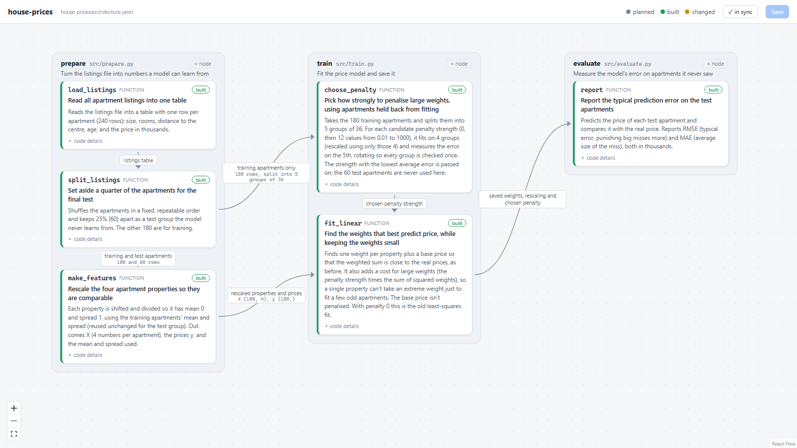

# Demo: the workflow on a small house-price model

A tiny project (240 synthetic apartments → features → linear price model → test error) and
one real feature request, done with the workflow. Everything below came from real Claude
Code sessions; the full conversation is in
[`docs/demo/session-transcript.md`](docs/demo/session-transcript.md).

## 0. Setup (once per project)

With the archspec plugin installed (see the main README), run `/archspec:setup` in the
project. It adds `architecture.yaml` and the rules in `CLAUDE.md`, turns on the
**archspec:Explain as you go** style, and opens the diagram.

## 1. Ask, and get a plan (no code yet)

> **You:** The model sometimes overreacts to small quirks in the training apartments. Add
> ridge regularisation (a penalty on large weights) and choose how strong the penalty
> should be using apartments the model didn't train on.

Claude read the code, wrote the plan into the spec as **planned / changed** steps, ran the
check, and **stopped**: "No code has changed yet … Tell me when to go ahead."

Review it in the diagram (`/archspec:view`):


The new step `choose_penalty` is *planned* (dashed), `fit_linear` is *changed* (amber). Each
card says in plain words what will happen, e.g. "splits the 180 training apartments into 5
groups of 36 … the 60 test apartments are never used here". You could edit any card or
arrow here before saying go.

## 2. Approve, and get a recap

> **You:** Looks good, go ahead.

Claude measured a baseline first (test error 24.3k), built it, verified it, updated the
spec, and ended with a recap. The key part, verbatim:

> **The ridge penalty is in, but it doesn't fix the problem.** The held-out check found that
> almost no penalty works best … test error went from 24.3k to 24.4k …
>
> **Watch out:** the overreaction probably isn't too-large weights. With 180 apartments and
> only 4 properties, the weights are already well determined … If a few apartments have
> unusual prices, they could pull the least-squares fit. Looking at the largest training
> residuals first would tell us whether that's the issue.

That is the method working: the change was built correctly **and** you learn that it
doesn't address the actual problem, with the evidence (a table of held-out error by
penalty) and a next step.



## 3. Understand it: `/archspec:walkthrough`

> **You:** /walkthrough   *(recorded before packaging; now `/archspec:walkthrough`)*

Result: [`docs/walkthroughs/2026-10-26-ridge-penalty.md`](docs/walkthroughs/2026-10-26-ridge-penalty.md)

- Each step explained in plain words; the real code is folded away under "Code: …".
- A **worked example** chosen so the effect shows: 20 apartments where *rooms* almost
  copies *size*. The printed output (real, not typed by Claude) shows the weights
  shrinking, size and rooms sharing the credit, and the held-out error falling from 20.1
  to 18.4 at the best penalty before rising again.
- Three questions with hidden answers. Claude asked the first one in chat:
  *"Why can it pick a nonzero penalty (0.66) when the scores look equal (24.03)?"*

## What to look at

| File | What it shows |
|---|---|
| `docs/demo/session-transcript.md` | The whole conversation, as you would see it |
| `docs/walkthroughs/2026-10-26-ridge-penalty.md` | The walkthrough |
| `architecture.yaml` | The map, now including `choose_penalty` |
| The "Exact changes" section of the walkthrough | Baseline code vs. after the feature |

## Run it yourself

```
cd demo/house-prices
python data/make_data.py        # regenerate the listings
python -m src.train             # prints held-out error per penalty, the chosen penalty, weights
python -m src.evaluate          # test error on the 60 unseen apartments
```

Then open Claude Code in this folder, run `/archspec:view`, and ask for the next feature,
e.g. "find out whether a few unusual apartments are pulling the fit" (the step Claude
suggested in its recap).
